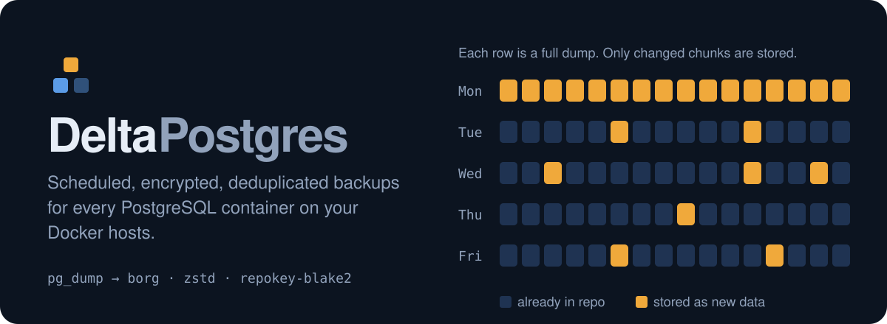
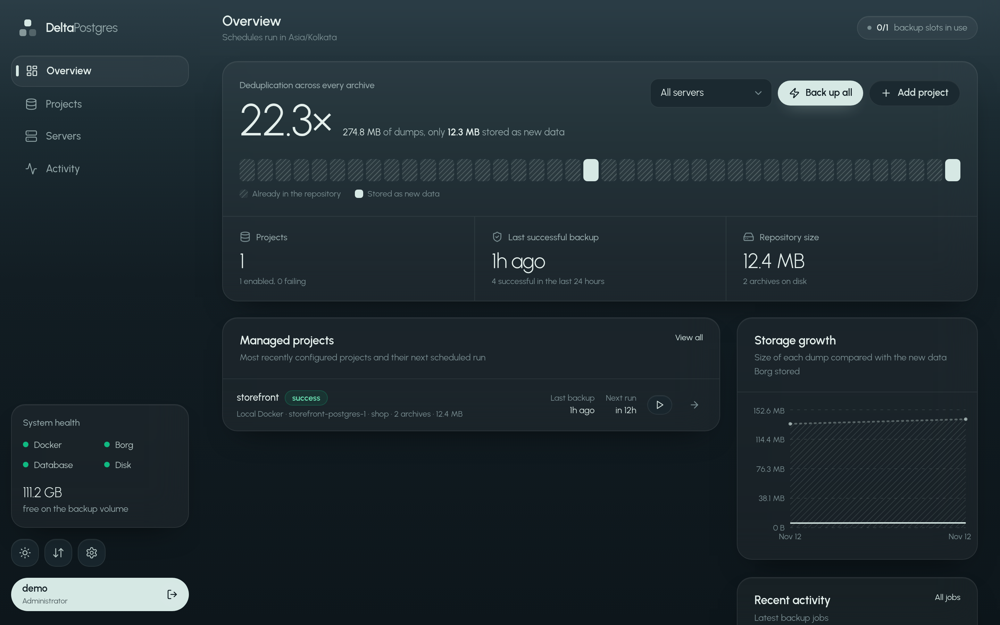
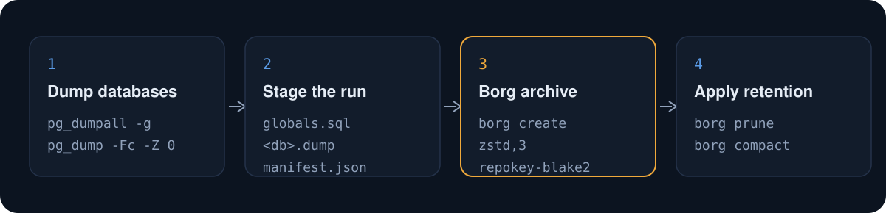
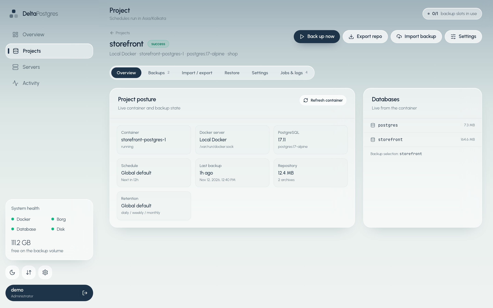

<picture>
  <source media="(prefers-color-scheme: light)" srcset="assets/readme/hero-light.svg">
  
</picture>

<p>
  <a href="LICENSE"></a>
  
  
  
</p>

DeltaPostgres is a self-hosted dashboard that finds the PostgreSQL containers on your Docker hosts, dumps them on a schedule, and keeps every dump in an encrypted, deduplicated [Borg](https://www.borgbackup.org/) repository. Each run is a full logical dump, but Borg only stores the chunks that changed.

<picture>
  <source media="(prefers-color-scheme: light)" srcset="assets/readme/screenshot-overview-light.png">
  
</picture>

<sub>A demo project after four backups: 274.8 MB of dumps, 12.3 MB actually stored.</sub>

## Why DeltaPostgres

- **Full dumps at incremental cost.** Dumps are written uncompressed (`pg_dump -Fc -Z 0`) so Borg can deduplicate them, then Borg compresses once with zstd. Unchanged tables cost almost nothing.
- **Zero-config discovery.** Every Docker Compose project on each connected host is scanned. Projects that contain PostgreSQL are added automatically with their databases and `POSTGRES_USER`.
- **One encrypted repository per project.** Each project gets its own `repokey-blake2` Borg repo, its own schedule and its own retention.
- **Safe restores by default.** Restores go into a new scratch database. Overwriting a live database requires typing its name.
- **Many hosts, one console.** Connect remote Docker hosts over SSH with a username and password, or over TCP/mutual TLS. Discovery, backups and restores are scoped per server.

> [!NOTE]
> This is logical backup with deduplicated storage, not WAL-level point-in-time recovery. If you need PITR, pair it with a tool such as pgBackRest.

## How it works

<picture>
  <source media="(prefers-color-scheme: light)" srcset="assets/readme/how-it-works-light.svg">
  
</picture>

For each run the dashboard executes inside the target container:

```bash
pg_dumpall -U <user> --globals-only
pg_dump    -U <user> -Fc -Z 0 -d <database>     # one per selected database
```

It writes a manifest, then creates one Borg archive and applies retention:

```bash
borg create --stats --json --compression auto,zstd,3 <repo>::<timestamp> .
borg prune  --keep-daily 7 --keep-weekly 4 --keep-monthly 6 <repo>
borg compact <repo>
```

The dashboard's own state lives in a separate PostgreSQL 17 container, which is labelled so it never appears in discovery.

## Quick start

You need a Linux host with Docker and Docker Compose.

**1. Clone and create `.env`**

```bash
git clone https://github.com/notzeman/delta-postgres.git
cd delta-postgres

cat > .env <<EOF
SESSION_SECRET=$(openssl rand -hex 32)
DASHBOARD_DB_PASSWORD=$(openssl rand -hex 24)
BORG_PASSPHRASE=$(openssl rand -hex 32)
SECRETS_KEY=$(openssl rand -hex 32)
COOKIE_SECURE=false
# Comma-separated hosts allowed to reach the dashboard, like Django.
ALLOWED_HOSTS=localhost,127.0.0.1
DASHBOARD_PORT=8095
EOF
chmod 600 .env
```

> [!IMPORTANT]
> Store `BORG_PASSPHRASE` in a password manager now. Without it, your backups cannot be restored.

**2. Start the stack**

```bash
mkdir -p data backups
docker compose up -d --build
```

**3. Create the first admin**

```bash
docker compose exec dashboard npm run create-admin
```

The command prompts for a username and a password of at least 8 characters. There are no default credentials.

**4. Run your first backup**

Open your configured domain and sign in. Requests are matched against `ALLOWED_HOSTS`; add every IP or domain you serve the dashboard from. Your PostgreSQL Compose projects are already listed under **Projects → Managed**. Open one and choose **Back up now**.

Check health at any time:

```bash
curl -s http://127.0.0.1:8095/api/health | jq
```

<p align="center">
  
</p>

## Using it

### Projects and discovery

- New Compose projects are picked up on startup, every five minutes, and whenever you choose **Rescan**.
- Opening **Managed** doesn't trigger a scan. Discovery runs on **Rescan** or when you open **Detected** or **Ignored**.
- Compose projects without PostgreSQL are listed under **Detected → Other Compose projects**.
- **Add project** onboards a container the scan missed, with live detection of its databases and user.
- The trash button **moves a project to Ignored**. Its archives, jobs and Borg repo are kept, and later scans won't re-add it. Restore it from **Ignored**.
- Turn off auto-add in **Settings → Global defaults**.

Opt a container out of discovery with a label:

```yaml
labels:
  backup.ignore: "true"   # or: backup.enable: "false"
```

If a container is recreated, its ID changes. Backups and restores re-resolve the container by name and Compose labels automatically, and **Refresh container** on the project page fixes it by hand.

### Docker servers

**Local Docker** is added automatically from `DOCKER_SOCKET`. Add remote hosts on the **Servers** page:

- **SSH** — the simplest option: an IP/hostname, SSH username, and SSH password. Port defaults to `22`. The dashboard connects over SSH and runs `docker system dial-stdio`; the SSH user must be in the `docker` group (or otherwise allowed to use Docker). Passwords are encrypted at rest with `SECRETS_KEY`.
- **TCP / TLS** — `http` on port 2375, or `https` on 2376 with an optional CA certificate, client certificate and key.
- Connections are tested before saving, and credentials are encrypted at rest with `SECRETS_KEY`
- **Scan now** discovers and auto-adds a server's PostgreSQL projects immediately
- Removing a server deletes its project records after a second confirmation. Borg repositories stay on disk.

### Backup safety

Backups are designed to be read-only against your projects:

- The only commands run inside a source container are `pg_dumpall --globals-only` and `pg_dump -Fc`. No `INSERT`, `UPDATE`, `DELETE`, `DROP`, or other writes happen during a backup.
- Newly discovered or added projects are scheduled for the **next cron occurrence**; adding a project never starts an immediate backup.
- Only projects that are **enabled** and not **ignored** are considered. Disabled projects are never backed up.
- **One backup per Docker server runs at a time.** The concurrency setting caps total jobs, but a single source host never gets parallel dumps.
- `pg_dump` uses `--lock-wait-timeout=30s`, so it aborts rather than waiting behind a DDL lock and blocking your application.
- Restores and dump imports are **manual only**. Overwriting a database requires typing `CONFIRM`, and nothing is restored on a schedule.
- Retention and pruning operate only inside the project's Borg repository. Source databases are never touched.

### Restore

Open a project and choose **Restore**:

1. Pick an archive. The **Database dump** list is read from that archive's `databases/*.dump` files.
2. Choose a **Target database**. The default is a new database named `restore_<db>_<date>`.
3. Optionally enable **Overwrite**. This terminates connections and drops the target, and you have to type the target name to confirm.

The dump is extracted from Borg and piped into `pg_restore` inside the container.

### Import and export

| Operation | Format | Where |
|---|---|---|
| Catalog only | JSON | Import / Export → Catalog |
| Single archive | `.tar` (`borg export-tar`) | Project → Import / export |
| Single project repository | `.tar` of the encrypted repo | Project → Import / export |
| Import an archive or repository | `.tar` upload | Project → Import / export |
| All repositories | `.tar` of `backups/` | Import / Export → All repositories |

An archive is the whole Borg archive, not a single dump: it contains `globals.sql`, `manifest.json` and one `databases/<name>.dump` per database. Archives are imported with `borg import-tar`. Importing a full repository replaces the project's repo and clears its Borg cache so a relocated repo can be adopted. Repositories must use the same `BORG_PASSPHRASE`.

Imported archives keep their original timestamps and are subject to retention. If an imported archive falls on the same day as an existing one, the next `borg prune` may remove one of them. The catalog reconciles with Borg automatically.

## Configuration

Schedules, timezone, concurrency, retention, the notification webhook and auto-add are set on the dashboard's **Settings** page. The `.env` file holds secrets and ports only.

| Variable | Required | Purpose | Generate |
|---|---|---|---|
| `SESSION_SECRET` | Yes | Signs login cookies. Rotating it signs everyone out. | `openssl rand -hex 32` |
| `DASHBOARD_DB_PASSWORD` | Yes | Password for the dashboard's own Postgres | `openssl rand -hex 24` |
| `BORG_PASSPHRASE` | Yes | Encrypts every Borg repository. **Unrecoverable if lost.** | `openssl rand -hex 32` |
| `SECRETS_KEY` | Yes | Encrypts stored remote Docker SSH passwords and TLS credentials | `openssl rand -hex 32` |
| `COOKIE_SECURE` | No | Set to `true` when serving over HTTPS | `false` / `true` |
| `ALLOWED_HOSTS` | No | Comma-separated IPs/domains allowed in the `Host` header. Empty or `*` allows all. | `localhost,127.0.0.1` |
| `DASHBOARD_PORT` | No | Host port published by Compose | `8095` |

<details>
<summary><strong>Optional overrides</strong></summary>

| Variable | Default | Purpose |
|---|---|---|
| `APP_UID` / `APP_GID` | auto-detected | Runtime UID/GID (`id -u` / `id -g`) |
| `DOCKER_GID` | socket GID | Docker socket group (`stat -c '%g' /var/run/docker.sock`) |
| `PORT` | `8080` | Container HTTP port |
| `DOCKER_SOCKET` | `/var/run/docker.sock` | Docker socket path |
| `LOG_LEVEL` | `info` | `debug`, `info`, `warn`, `error` |
| `DATABASE_URL` | built by Compose | External metadata database |
| `DATA_DIR` | `/data` | Runtime state directory |
| `BACKUP_ROOT` | `/backups` | Borg repository root |

The entrypoint starts as root only long enough to detect the owner of `./data` and the Docker socket group, fix ownership, and drop privileges. You only need `APP_UID`, `APP_GID` or `DOCKER_GID` for rootless Docker, a custom socket, or unusual host ownership.

</details>

<details>
<summary><strong>Secret handling</strong></summary>

- `.env` is gitignored. Keep it `chmod 600`.
- Changing `BORG_PASSPHRASE` doesn't re-encrypt existing repositories. Use `borg key export` for a portable key backup.
- `SECRETS_KEY` must stay stable. Changing it invalidates stored SSH passwords and TLS certificates, and you'll have to re-enter them on the **Servers** page.
- `DASHBOARD_DB_PASSWORD` must match the actual Postgres role. If you change it after the volume exists, update the role inside `dashboard-db` too.

</details>

<details>
<summary><strong>Data layout</strong></summary>

```text
data/
  logs/job-<id>.log
  secrets/session.secret
  secrets/borg.passphrase        # only when BORG_PASSPHRASE is not set
  staging/                       # temporary dumps, cleaned after each run
backups/
  <project-slug>/repo/           # local server
  servers/<server-slug>/<project-slug>/repo/   # remote servers
```

</details>

## Security

> [!WARNING]
> The dashboard has root-equivalent control over every Docker host it connects to. Don't expose it to the public internet.

- Keep it on a private network, a VPN, or behind a reverse proxy with authentication and TLS.
- Restrict which hostnames can reach the dashboard with `ALLOWED_HOSTS`. It accepts a comma-separated list of IPs and domains, matching Django semantics. Remove an IP or domain here to block requests that use it in the `Host` header. An empty value (or `*`) disables the check.
- The port is published on all interfaces by default so a reverse proxy or direct IP access can work. Use `ALLOWED_HOSTS` to gate access, and restrict the port in your cloud firewall or security group as well, since Docker port publishing bypasses `ufw`.
- Plain `http` Docker API access is unauthenticated. Prefer mutual TLS, or keep the API on a private network or WireGuard tunnel.
- Admin passwords are bcrypt-hashed in the metadata database. Sessions use an httpOnly JWT cookie, and logins are rate limited and audit logged.

## Limits

- **One scheduler.** The in-process queue assumes a single dashboard replica.
- **One container per project.** A project maps to one PostgreSQL container, which can hold many databases.
- **Logical dumps only.** Consistency is per database, and there's no WAL or PITR.
- **Local disk.** Repositories live in `./backups`. Free space is shown in the health panel.

## Troubleshooting

<details>
<summary><code>No admin user configured</code> on the login page</summary>

```bash
docker compose exec dashboard npm run create-admin   # first user
docker compose exec dashboard npm run reset-admin    # forgotten password
```

</details>

<details>
<summary><code>permission denied</code> on <code>/var/run/docker.sock</code></summary>

The entrypoint detects the socket GID automatically. With a custom socket or rootless Docker, set `DOCKER_GID` and recreate the container. To check the runtime user:

```bash
docker compose exec dashboard sh -c 'grep -E "^(Uid|Gid|Groups)" /proc/1/status'
```

</details>

<details>
<summary><code>no such container</code> after recreating a Compose service</summary>

Backup and restore re-resolve the container by name, then by Compose project and service. Choose **Refresh container** on the project page to repair it by hand.

</details>

<details>
<summary>An archive disappears after import or prune</summary>

Retention may have pruned an imported archive that shared a day with another one. Refresh the archive list from **Restore** or **Backups → Sync** and choose an archive that still exists. Leave `.tar` out of imported archive names.

</details>

<details>
<summary><code>role ... does not exist</code> from <code>pg_dump</code></summary>

Set the project's PostgreSQL user in its settings, or make sure `POSTGRES_USER` is set on the container.

</details>

<details>
<summary>Borg lock errors</summary>

A previous run may still hold the lock. Check `docker compose logs dashboard`, then run `borg break-lock <repo>` inside the container.

</details>

<details>
<summary>A remote Docker server shows as offline</summary>

Check that the Docker Engine API is reachable from the dashboard container, that the host and port are right (22 for SSH, 2375 for `http`, 2376 for `https`), and that credentials or TLS certificates match. **Servers → Test** shows the exact error. For SSH, confirm the user is in the `docker` group: `ssh user@host 'docker version'`.

</details>

## Development

```bash
docker compose up -d dashboard-db          # metadata database only
npm install && npm --prefix web install

# Terminal 1: API on :8080
DATABASE_URL=postgres://dashboard:<password>@localhost:5432/backup_dashboard \
SESSION_SECRET=dev-secret BORG_PASSPHRASE=dev-passphrase \
npm run dev:server

# Terminal 2: Vite on :5173, proxies /api
npm run dev:web

# Terminal 3: create an admin (the API creates the schema on startup)
DATABASE_URL=postgres://dashboard:<password>@localhost:5432/backup_dashboard \
npm run create-admin:dev
```

`npm run build` builds both apps, and the API serves `web/dist` in production. `npm run typecheck` checks both.

```text
src/                 Fastify API, Docker and Borg services, scheduler, job queue
web/                 React 19 + Vite + Tailwind dashboard
assets/readme/       README artwork (generate.py rebuilds the SVGs)
Dockerfile           Multi-stage build: React, TypeScript and the Borg runtime
docker-compose.yml   Dashboard + metadata Postgres
```

<details>
<summary><strong>API overview</strong></summary>

| Method | Path | Description |
|---|---|---|
| `POST` | `/api/auth/login` | Sign in |
| `GET` | `/api/health` | Docker, Borg, database and disk health |
| `GET` | `/api/stats` | Dashboard totals and chart data |
| `GET` | `/api/discovery` | Detected Compose projects (`?serverId=`) |
| `GET` | `/api/containers` | Containers for manual add (`?serverId=`) |
| `GET/POST` | `/api/servers` | List or add Docker servers |
| `PATCH/DELETE` | `/api/servers/:id` | Update or remove a Docker server |
| `POST` | `/api/servers/test` | Test a connection before saving |
| `POST` | `/api/servers/:id/test` | Test an existing server |
| `POST` | `/api/servers/:id/scan` | Discover and auto-add projects on a server |
| `GET/POST` | `/api/projects` | List or create projects (`?serverId=`) |
| `GET/PATCH/DELETE` | `/api/projects/:id` | Project details, update, remove |
| `POST` | `/api/projects/:id/backup` | Queue a manual backup |
| `POST` | `/api/backups` | Queue all enabled projects |
| `GET` | `/api/projects/:id/archives` | Archive catalog |
| `POST` | `/api/projects/:id/archives/:name/verify` | Verify an archive (`borg check --verify-data`) |
| `POST` | `/api/projects/:id/restore` | Restore a database |
| `GET` | `/api/projects/:id/archives/:name/export` | Export an archive as tar |
| `GET` | `/api/projects/:id/export` | Export a repository as tar |
| `GET` | `/api/export/catalog` | Export the catalog as JSON |
| `GET` | `/api/export/all` | Export all repositories |
| `POST` | `/api/import` | Import an archive or repository tar |
| `GET` | `/api/jobs` | Job history |
| `GET` | `/api/jobs/:id` | Job details and log tail |
| `GET/PATCH` | `/api/settings` | Global defaults |

</details>

## License

[MIT](LICENSE) © notzeman
